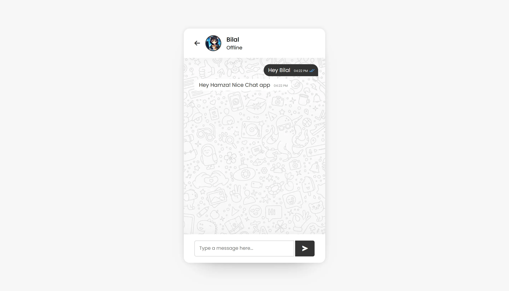
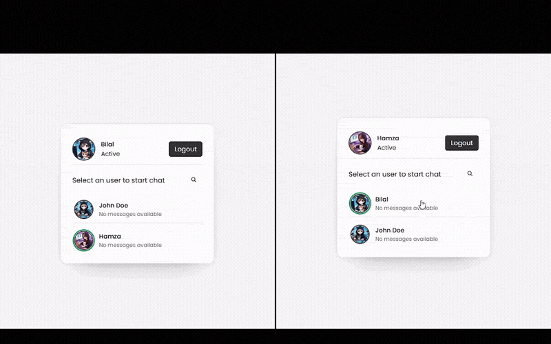

# Chit Chat App

A modern real-time chat application that allows users to create accounts, authenticate, view users, and exchange messages instantly without refreshing the page.

## 🎯 Main Goal

Build a smooth real-time communication platform demonstrating WebSocket-based messaging, user authentication, and modern full-stack development practices.

## ✨ Core Features

- User registration and login
- Form validation
- Secure authentication system
- User list / contacts
- One-to-one private messaging
- Real-time message delivery
- Typing indicators
- Instant updates without page refresh
- Chat history
- Responsive chat interface

## 📸 Demo

### Login

### Signup

### User List

### Chat Interface

### Real-Time Chat in Action

*Two users exchanging messages in real time.*

## 🛠️ Technology Stack

### Frontend
- HTML / CSS / JavaScript
- Modern UI components
- Responsive design

### Backend
- Core PHP / PHP backend
- WebSocket real-time communication

### Database
- MySQL

## 🏗️ Architecture

The application follows a structured MVC-inspired architecture using Object-Oriented Programming principles with PDO for database communication. The system is separated into the following layers:

| Layer | Responsibility |
|---|---|
| **Presentation Layer** | Handles the user interface and user interactions. |
| **Controller Layer** | Receives requests, validates data, and connects the interface with application logic. |
| **Business Logic Layer** | Handles core operations such as authentication, messaging, and user management. |
| **Model Layer** | Represents application entities and manages data operations using OOP principles. |
| **Database Layer** | Uses PDO with prepared statements for secure MySQL database communication. |

### Real-Time Communication

A WebSocket server handles bidirectional communication between connected users, allowing messages and typing events to be delivered instantly without refreshing the page.

## 🔒 Security

- Password hashing
- PDO prepared statements
- Server-side validation
- Authentication management

## 🧠 Concepts Demonstrated

- Client-server communication
- Real-time bidirectional communication
- Authentication flow
- Database-driven messaging
- Full-stack application architecture

## 👥 Target Audience

Developers, recruiters, and anyone interested in seeing a full-stack real-time chat implementation.

## 📌 Project Status

Completed personal portfolio project.

## 📄 License

Proprietary software. All rights reserved © 2025 Hamza.

The code cannot be copied, modified, or distributed without permission.