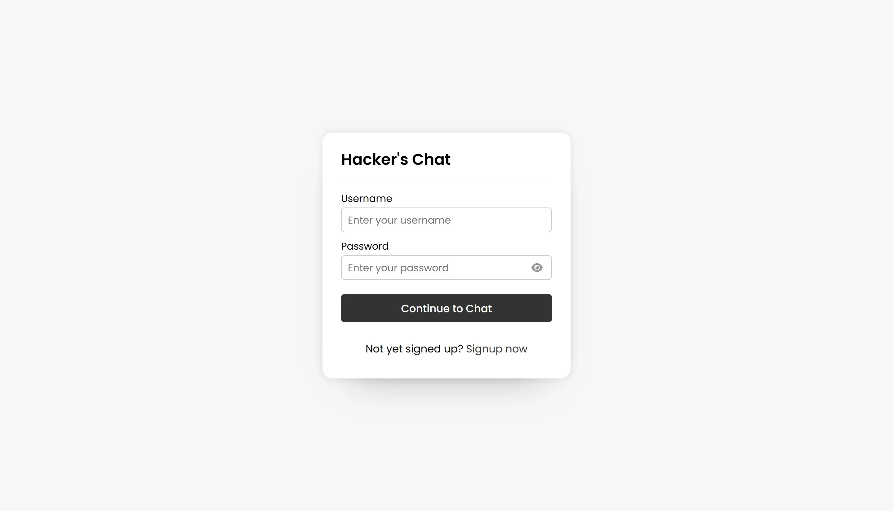
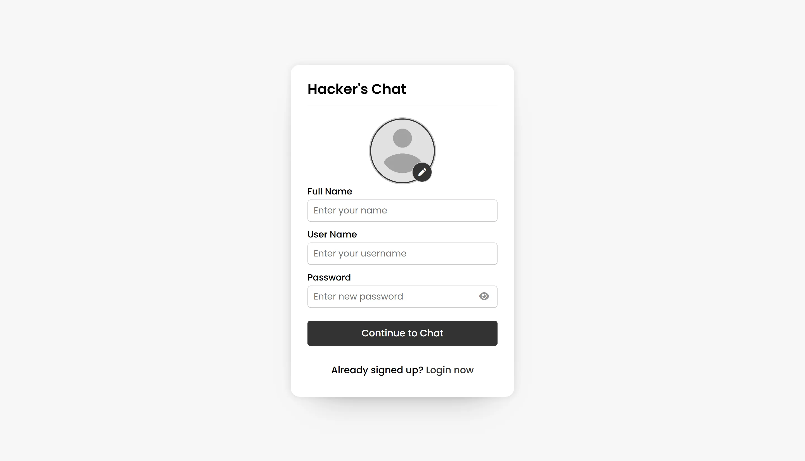
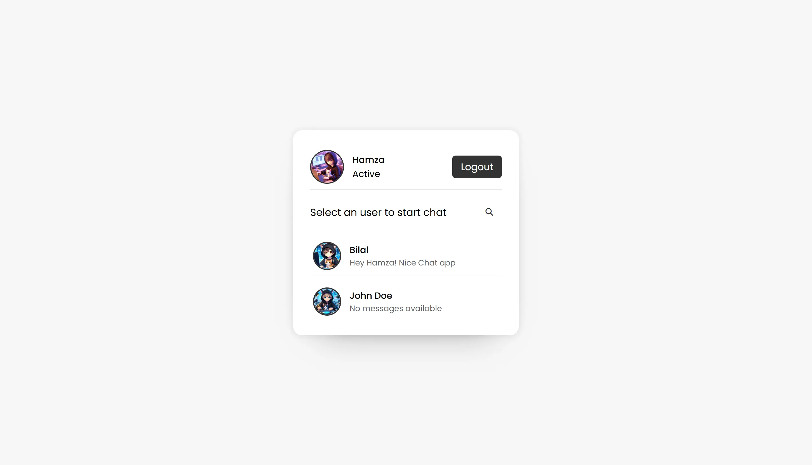

# 💬 Chit Chat

**A real-time one-to-one chat application built with Core PHP, WebSockets and MySQL.**

[Portfolio](https://hamzaamir-portfolio.web.app/) · [LinkedIn](https://www.linkedin.com/in/hamza-aamir-dev/) · [GitHub](https://github.com/x-hamza47)

---

## 📖 Overview

Chit Chat is a modern real-time messaging platform that lets users create accounts, sign in securely, browse other users and exchange private messages instantly, with no page refresh. It demonstrates WebSocket-based communication, secure authentication and a clean, layered full-stack architecture.

## ✨ Features

- 🔐 **User registration and login** with client- and server-side form validation
- 🛡️ **Secure authentication** with hashed passwords and session management
- 👥 **User list / contacts** to start a conversation with anyone
- 💬 **One-to-one private messaging**
- ⚡ **Real-time delivery** over WebSockets
- ✍️ **Typing indicators** so you know when someone is replying
- 🗂️ **Persistent chat history** stored in MySQL
- 📱 **Responsive interface** that works on desktop and mobile

## 📸 Demo

### Authentication

| Login | Signup |
|:---:|:---:|
|  |  |

### Chat

| User List | Chat Interface |
|:---:|:---:|
|  |  |

### Real-Time Chat in Action

*Two users exchanging messages in real time.*

## 🛠️ Tech Stack

| Area | Technologies |
|---|---|
| **Frontend** | HTML5, CSS3, JavaScript, responsive UI |
| **Backend** | Core PHP (OOP), WebSocket server |
| **Database** | MySQL via PDO |

## 🏗️ Architecture

The project follows an MVC-inspired structure built on Object-Oriented Programming principles, with PDO for all database access.

| Layer | Responsibility |
|---|---|
| **Presentation** | User interface and user interactions |
| **Controller** | Receives requests, validates data and connects the UI with application logic |
| **Business Logic** | Core operations such as authentication, messaging and user management |
| **Model** | Application entities and data operations using OOP |
| **Database** | PDO with prepared statements for secure MySQL communication |

### Real-Time Communication

A WebSocket server maintains persistent, bidirectional connections between clients. Messages and typing events are pushed to the recipient the moment they are sent, so conversations update instantly without polling or reloading.

## 🔒 Security

- Password hashing
- PDO prepared statements to prevent SQL injection
- Server-side validation of all input
- Authentication and session management

## 🧠 Concepts Demonstrated

- Client-server communication
- Real-time bidirectional communication with WebSockets
- Authentication flow
- Database-driven messaging
- Full-stack application architecture

## 👤 Author

**Hamza Aamir**, Full Stack Developer (React, Node.js, Laravel, PHP)

- 🌐 Portfolio: [hamzaamir-portfolio.web.app](https://hamzaamir-portfolio.web.app/)
- 💼 LinkedIn: [linkedin.com/in/hamza-aamir-dev](https://www.linkedin.com/in/hamza-aamir-dev/)
- 🐙 GitHub: [@x-hamza47](https://github.com/x-hamza47)
- 📧 Email: [hamzaamir72007@gmail.com](mailto:hamzaamir72007@gmail.com)

Interested in working together? Check out my [portfolio](https://hamzaamir-portfolio.web.app/) for more projects.

## 📄 License

Proprietary software. All rights reserved © 2025 Hamza Aamir.

This code may not be copied, modified or distributed without prior written permission.
